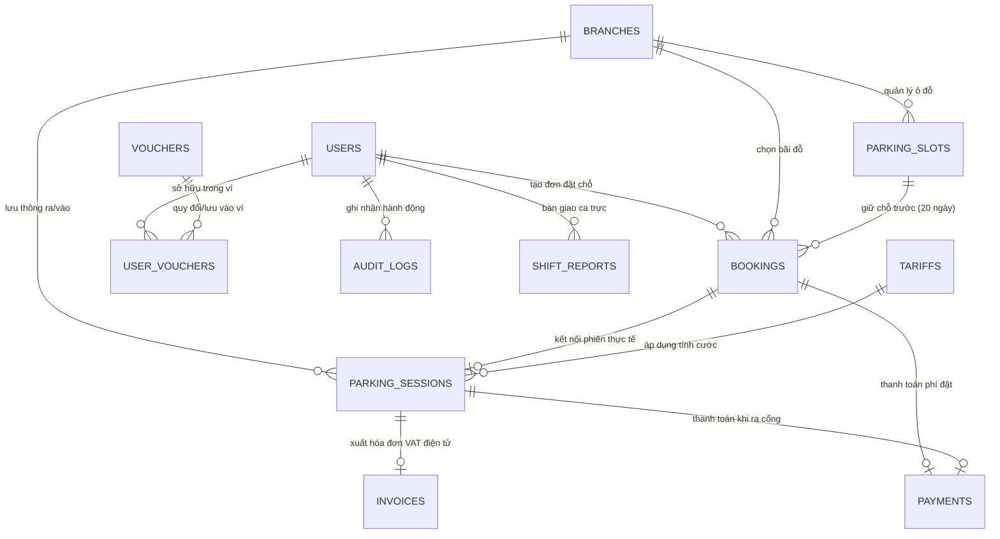

# BẢNG DỮ LIỆU HỆ THỐNG SMARTPARK ĐÀ NẴNG
## (Hệ Thống Quản Trị & Vận Hành Bãi Đỗ Xe Thông Minh Chuẩn Doanh Nghiệp)

---

> **Dự án**: CS445S - Đồ Án Tích Hợp Hệ Thống  
> **Cơ sở dữ liệu**: PostgreSQL 16 (Database: `smartpark` tại `localhost:5432`)  
> **Backend Stack**: Node.js, Express.js REST API, JWT Authentication (RBAC), Socket.IO Realtime, Gemini AI Assistant  
> **Frontend Stack**: React 18, Vite, Bootstrap, Lucide Icons, Html5-QRCode, Canvas Confetti  

---

## 1. SƠ ĐỒ QUAN HỆ THỰC THỂ (ERD - ENTITY RELATIONSHIP DIAGRAM)

---

## 2. CHI TIẾT 12 BẢNG DỮ LIỆU TRONG POSTGRESQL

### 2.1. BẢNG `users` - Tài Khoản Người Dùng & Phân Quyền Hệ Thống
Bảng quản lý tài khoản khách hàng và nhân sự điều hành (Quản trị viên, Nhân viên bốt trực). Mật khẩu được mã hóa an toàn bằng thuật toán `bcrypt`.

| Tên Cột | Kiểu Dữ Liệu | Ràng Buộc | Ý Nghĩa / Mô Tả Thực Tế |
| :--- | :--- | :--- | :--- |
| `id` | `VARCHAR(50)` | **PRIMARY KEY** | Mã định danh duy nhất (VD: `USR-01`, `USR-1789982733159`) |
| `email` | `VARCHAR(100)` | **UNIQUE, NOT NULL** | Địa chỉ thư điện tử dùng để đăng nhập và nhận hóa đơn |
| `password_hash` | `VARCHAR(255)` | **NOT NULL** | Chuỗi mật khẩu băm mã hóa an toàn bằng chuẩn **bcrypt** |
| `full_name` | `VARCHAR(100)` | **NOT NULL** | Họ và tên đầy đủ của chủ tài khoản |
| `phone` | `VARCHAR(20)` | Nullable | Số điện thoại liên hệ nhận SMS/OTP xác thực |
| `role` | `VARCHAR(20)` | Default `'customer'` | Phân quyền RBAC: `customer` (Khách hàng), `staff` (Nhân viên), `admin` (Quản trị viên) |
| `avatar_url` | `TEXT` | Nullable | Đường dẫn ảnh đại diện người dùng |
| `loyalty_tier` | `VARCHAR(30)` | Default `'Thành viên Bạc'` | Hạng hội viên: `Thành viên Mới`, `Thành viên Bạc`, `Thành viên Vàng`, `Thành viên Kim Cương` |
| `park_points` | `INTEGER` | Default `1250` | Điểm thưởng ParkPoints dùng để đổi voucher giảm giá |
| `created_at` | `TIMESTAMP` | Default `CURRENT_TIMESTAMP` | Thời điểm đăng ký tài khoản vào hệ thống |
| `updated_at` | `TIMESTAMP` | Default `CURRENT_TIMESTAMP` | Thời điểm cập nhật hồ sơ gần nhất |

---

### 2.2. BẢNG `branches` - Danh Sách 5 Chi Nhánh Bãi Đỗ Xe Tại TP. Đà Nẵng
Quản lý hạ tầng 5 trung tâm đỗ xe thông minh trên địa bàn thành phố Đà Nẵng.

| Tên Cột | Kiểu Dữ Liệu | Ràng Buộc | Ý Nghĩa / Mô Tả Thực Tế |
| :--- | :--- | :--- | :--- |
| `id` | `VARCHAR(50)` | **PRIMARY KEY** | Mã chi nhánh: `BR-01` đến `BR-05` |
| `name` | `VARCHAR(150)` | **NOT NULL** | Tên trung tâm bãi xe (VD: SmartPark - Aeon Mall Thanh Khê 1) |
| `district` | `VARCHAR(100)` | **NOT NULL** | Quận hành chính tại Đà Nẵng (Thanh Khê, Sơn Trà, Hải Châu, ...) |
| `address` | `TEXT` | **NOT NULL** | Địa chỉ thực tế của trạm bãi xe |
| `total_slots` | `INTEGER` | Default `200` | Tổng số lượng ô đỗ phương tiện được thiết kế |
| `ev_slots` | `INTEGER` | Default `10` | Số ô đỗ chuyên dụng tích hợp trụ sạc nhanh xe điện EV (120kW) |
| `floors` | `TEXT` | **NOT NULL** | Danh sách các tầng đỗ xe (VD: `"G,B1,B2,B3"`) |
| `barrier_ai_status` | `VARCHAR(50)` | Default `'Online (AI 99.4%)'` | Trạng thái cổng barrier và độ chính xác nhận diện biển số AI |
| `status` | `VARCHAR(30)` | Default `'Hoạt động'` | Tình trạng vận hành: `Hoạt động`, `Bảo trì`, `Đầy chỗ` |
| `created_at` | `TIMESTAMP` | Default `CURRENT_TIMESTAMP` | Ngày cấu hình trạm |

---

### 2.3. BẢNG `parking_slots` - Sơ Đồ Ô Đỗ Từng Tầng
Quản lý trạng thái vật lý của từng vị trí đỗ xe tại các tầng ngầm và tầng nổi.

| Tên Cột | Kiểu Dữ Liệu | Ràng Buộc | Ý Nghĩa / Mô Tả Thực Tế |
| :--- | :--- | :--- | :--- |
| `id` | `VARCHAR(50)` | **PRIMARY KEY** | Mã ô đỗ toàn hệ thống (VD: `SL-001`, `SL-002`) |
| `branch_id` | `VARCHAR(50)` | **FOREIGN KEY (branches.id)** | Thuộc chi nhánh nào |
| `slot_code` | `VARCHAR(30)` | **NOT NULL** | Mã vị trí in trên mặt sàn (VD: `B1-08`, `A-14`, `EV-02`) |
| `floor` | `VARCHAR(10)` | **NOT NULL** | Tầng đỗ: `G`, `B1`, `B2`, `B3` |
| `slot_type` | `VARCHAR(30)` | Default `'car'` | Loại ô: `car` (4-7 chỗ), `suv` (bán tải/SUV), `ev` (xe điện), `bike` (xe máy) |
| `status` | `VARCHAR(30)` | Default `'available'` | Trạng thái: `available` (Trống), `occupied` (Có xe), `reserved` (Đã đặt trước), `maintenance` (Đang bảo trì) |
| `created_at` | `TIMESTAMP` | Default `CURRENT_TIMESTAMP` | Ngày tạo ô |

---

### 2.4. BẢNG `tariffs` - Bảng Cấu Hình Biểu Phí Động
Động cơ tính toán cước giữ xe cho hệ thống bốt tự động và đặt chỗ trực tuyến.

| Tên Cột | Kiểu Dữ Liệu | Ràng Buộc | Ý Nghĩa / Mô Tả Thực Tế |
| :--- | :--- | :--- | :--- |
| `id` | `VARCHAR(50)` | **PRIMARY KEY** | Mã biểu phí (VD: `T-01`, `T-02`, `T-03`, `T-04`) |
| `vehicle_type` | `VARCHAR(100)` | **NOT NULL** | Tên phân loại (Ô tô con 4-7 chỗ, SUV/Bán tải, Ô tô điện EV, Xe máy) |
| `first_2_hours` | `INTEGER` | **NOT NULL** | Cước 2 giờ đầu tiên (VD: 25.000đ đối với ô tô con) |
| `next_hour` | `INTEGER` | **NOT NULL** | Cước mỗi giờ tiếp theo (VD: 10.000đ/giờ) |
| `day_rate` | `INTEGER` | **NOT NULL** | Vé trọn gói 24h (VD: 150.000đ) |
| `week_rate` | `INTEGER` | **NOT NULL** | Gói Tuần ưu đãi (7 ngày): 650.000đ |
| `month_rate` | `INTEGER` | **NOT NULL** | Gói Tháng ưu đãi (30 ngày): 1.800.000đ |
| `note` | `TEXT` | Nullable | Ghi chú điều kiện áp dụng |
| `updated_at` | `TIMESTAMP` | Default `CURRENT_TIMESTAMP` | Thời điểm cập nhật giá vé gần nhất |

---

### 2.5. BẢNG `bookings` - Quản Lý Đơn Đặt Chỗ Trước (Hạn Vé 20 Ngày)
Lưu trữ các đơn đặt chỗ trước trên ứng dụng di động/web, tự động sinh mã thẻ thông hành QR Pass.

| Tên Cột | Kiểu Dữ Liệu | Ràng Buộc | Ý Nghĩa / Mô Tả Thực Tế |
| :--- | :--- | :--- | :--- |
| `id` | `VARCHAR(50)` | **PRIMARY KEY** | Mã vé đặt chỗ trước (VD: `BK-8821`, `BK-2026-99`) |
| `user_id` | `VARCHAR(50)` | **FOREIGN KEY (users.id)** | Khách hàng sở hữu vé |
| `branch_id` | `VARCHAR(50)` | **FOREIGN KEY (branches.id)** | Bãi đỗ xe đã chọn tại Đà Nẵng |
| `slot_code` | `VARCHAR(30)` | **NOT NULL** | Vị trí đỗ đã chọn trước (VD: `B-08`, `A-14`) |
| `floor` | `VARCHAR(10)` | **NOT NULL** | Tầng đỗ |
| `license_plate` | `VARCHAR(20)` | **NOT NULL** | Biển số xe đăng ký khớp lệnh camera AI ANPR |
| `vehicle_type` | `VARCHAR(50)` | Default `'car'` | Phân loại xe |
| `package_type` | `VARCHAR(30)` | Default `'day'` | Gói vé: `hourly` (theo giờ), `day` (24h), `week` (7 ngày), `month` (30 ngày) |
| `start_time` | `TIMESTAMP` | **NOT NULL** | Thời gian hiệu lực bắt đầu |
| `end_time` | `TIMESTAMP` | **NOT NULL** | Thời gian hết hạn vé |
| `validity_days` | `INTEGER` | Default `20` | Quy chuẩn thời hạn giữ vé tối đa là **20 ngày** |
| `total_cost` | `INTEGER` | **NOT NULL** | Số tiền thanh toán thực tế sau khi đã trừ voucher |
| `payment_method` | `VARCHAR(50)` | **NOT NULL** | Cổng thanh toán: `VietQR Napas 247`, `MoMo`, `ZaloPay`, `Visa` |
| `qr_pass_code` | `VARCHAR(150)` | **NOT NULL** | Chuỗi dữ liệu mã hóa của QR Pass độc quyền SmartPark |
| `status` | `VARCHAR(30)` | Default `'confirmed'` | Tình trạng: `confirmed` (Hiệu lực), `completed` (Đã đỗ xong), `expired` (Quá hạn) |
| `created_at` | `TIMESTAMP` | Default `CURRENT_TIMESTAMP` | Thời điểm thanh toán và đặt chỗ thành công |

---

### 2.6. BẢNG `parking_sessions` - Phiên Gửi Xe Thời Gian Thực (Check-in & Check-out)
Theo dõi hành trình xe ra vào qua trạm ANPR nhận diện biển số và kiểm soát mở barrier.

| Tên Cột | Kiểu Dữ Liệu | Ràng Buộc | Ý Nghĩa / Mô Tả Thực Tế |
| :--- | :--- | :--- | :--- |
| `id` | `VARCHAR(50)` | **PRIMARY KEY** | Mã phiên gửi xe (VD: `SES-2026-001`) |
| `branch_id` | `VARCHAR(50)` | **FOREIGN KEY (branches.id)** | Trạm bãi xe phát sinh lượt gửi |
| `license_plate` | `VARCHAR(20)` | **NOT NULL** | Biển số do camera AI OCR trích xuất |
| `checkin_time` | `TIMESTAMP` | Default `CURRENT_TIMESTAMP` | Thời khắc xe vượt qua vạch nhận diện vào |
| `checkout_time` | `TIMESTAMP` | Nullable | Thời khắc xe ra khỏi bãi (null nếu đang đỗ) |
| `checkin_gate` | `VARCHAR(50)` | Default `'Cổng Vào 01'` | Làn kiểm soát vào |
| `checkout_gate` | `VARCHAR(50)` | Nullable | Làn kiểm soát ra |
| `checkin_image` | `TEXT` | Nullable | Ảnh chụp toàn cảnh đầu xe và biển số lúc vào |
| `checkout_image` | `TEXT` | Nullable | Ảnh chụp đối chiếu biển số lúc ra |
| `booking_id` | `VARCHAR(50)` | Nullable, FK (bookings.id) | Khớp lệnh nếu khách có vé đặt trước |
| `total_amount` | `INTEGER` | Default `0` | Tổng phí cước lưu bãi |
| `payment_status` | `VARCHAR(30)` | Default `'Đang gửi'` | Trạng thái: `Đang gửi`, `Đã thanh toán`, `Miễn phí` |
| `barrier_status` | `VARCHAR(30)` | Default `'Đóng'` | Trạng thái cần gạt: `Đóng`, `Đang mở (AI)`, `Mở cưỡng chế (F4)` |

---

### 2.7. BẢNG `invoices` - Hóa Đơn Điện Tử VAT Chuẩn Tổng Cục Thuế
Phát hành hóa đơn điện tử tự động có mã cơ quan thuế cho mọi giao dịch ra bãi hoặc đặt trước.

| Tên Cột | Kiểu Dữ Liệu | Ràng Buộc | Ý Nghĩa / Mô Tả Thực Tế |
| :--- | :--- | :--- | :--- |
| `id` | `VARCHAR(50)` | **PRIMARY KEY** | Mã tra cứu hóa đơn hệ thống (VD: `INV-0004928`) |
| `invoice_code` | `VARCHAR(50)` | **UNIQUE, NOT NULL** | Số hóa đơn chính thức định dạng 7 chữ số (`0004928`) |
| `session_id` | `VARCHAR(50)` | Nullable | Mã phiên gửi xe liên kết |
| `booking_id` | `VARCHAR(50)` | Nullable | Mã vé đặt chỗ liên kết |
| `buyer_name` | `VARCHAR(100)` | **NOT NULL** | Tên khách hàng hoặc tên công ty xuất hóa đơn |
| `buyer_tax_code` | `VARCHAR(30)` | Nullable | Mã số thuế doanh nghiệp (nếu yêu cầu xuất VAT công ty) |
| `license_plate` | `VARCHAR(20)` | **NOT NULL** | Biển kiểm soát phương tiện |
| `subtotal` | `INTEGER` | **NOT NULL** | Tiền dịch vụ trông giữ trước thuế |
| `vat_rate` | `INTEGER` | Default `8` | Thuế suất Giá Trị Gia Tăng: **8%** |
| `vat_amount` | `INTEGER` | **NOT NULL** | Tiền thuế VAT (8%) |
| `total_amount` | `INTEGER` | **NOT NULL** | Tổng tiền thanh toán cuối cùng đã bao gồm VAT |
| `payment_method` | `VARCHAR(50)` | **NOT NULL** | Hình thức thanh toán (VietQR Napas, MoMo, ZaloPay, Tiền mặt) |
| `digital_signature`| `TEXT` | **NOT NULL** | Chữ ký số điện tử SmartPark Authority |
| `signed_at` | `TIMESTAMP` | Default `CURRENT_TIMESTAMP` | Thời điểm ký số và gửi lên hệ thống hóa đơn |

---

### 2.8. BẢNG `vouchers` - Danh Mục Voucher Khuyến Mãi Hệ Thống
Quản lý các chương trình ưu đãi đổi điểm ParkPoints và mã code tri ân.

| Tên Cột | Kiểu Dữ Liệu | Ràng Buộc | Ý Nghĩa / Mô Tả Thực Tế |
| :--- | :--- | :--- | :--- |
| `id` | `VARCHAR(50)` | **PRIMARY KEY** | Mã chương trình (VD: `V-01`, `V-08`) |
| `code` | `VARCHAR(50)` | **UNIQUE, NOT NULL** | Ký hiệu mã khuyến mãi (VD: `POINT20K`, `SMARTPARK2026`) |
| `title` | `VARCHAR(150)` | **NOT NULL** | Tên hiển thị của voucher |
| `pts_cost` | `INTEGER` | Default `0` | Số điểm ParkPoints cần để đổi (0 nếu là mã quà tặng nhập tay) |
| `discount_val` | `VARCHAR(30)` | **NOT NULL** | Giá trị giảm trừ: số tiền cố định (`20000`, `50000`) hoặc phần trăm (`20%`, `25%`) |
| `used_count` | `INTEGER` | Default `0` | Số lượt người dùng đã đổi/áp dụng thực tế |
| `max_use` | `INTEGER` | Default `500` | Giới hạn phát hành tối đa |
| `expiry_date` | `VARCHAR(50)` | **NOT NULL** | Hạn sử dụng của chương trình |
| `status` | `VARCHAR(30)` | Default `'Kích hoạt'` | Tình trạng: `Kích hoạt`, `Tạm dừng`, `Hết lượt` |

---

### 2.9. BẢNG `user_vouchers` - Ví Voucher Của Người Dùng (Chống Đổi Trùng Lặp)
Bảo đảm tính toàn vẹn: sau khi khách hàng đổi điểm hoặc lưu mã, voucher lập tức chuyển vào ví cá nhân và **không thể đổi lại lần thứ hai gây mất điểm thưởng**.

| Tên Cột | Kiểu Dữ Liệu | Ràng Buộc | Ý Nghĩa / Mô Tả Thực Tế |
| :--- | :--- | :--- | :--- |
| `id` | `VARCHAR(50)` | **PRIMARY KEY** | Mã vé giảm giá trong ví cá nhân (VD: `UV-01`, `UV-17899827`) |
| `user_id` | `VARCHAR(50)` | **FOREIGN KEY (users.id)** | Khách hàng sở hữu |
| `voucher_code` | `VARCHAR(50)` | **NOT NULL** | Mã code tương ứng |
| `title` | `VARCHAR(150)` | **NOT NULL** | Tiêu đề ưu đãi |
| `discount_type` | `VARCHAR(20)` | Default `'fixed'` | Phân loại giảm: `fixed` (tiền mặt) hoặc `percent` (phần trăm) |
| `discount_val` | `INTEGER` | Default `20000` | Trị giá giảm tính theo VNĐ hoặc % |
| `pts_cost` | `INTEGER` | Default `0` | Điểm thưởng đã khấu trừ khi đổi |
| `source` | `VARCHAR(30)` | Default `'claimed'` | Nguồn nhận: `redeemed` (đổi điểm), `code` (nhập mã quà tặng), `welcome_gift` |
| `is_used` | `INTEGER` | Default `0` | `0`: Còn trong ví chưa dùng; `1`: Đã sử dụng khi thanh toán đặt chỗ |
| `used_at` | `TIMESTAMP` | Nullable | Thời điểm áp dụng vào đơn đặt chỗ |
| `claimed_at` | `TIMESTAMP` | Default `CURRENT_TIMESTAMP` | Thời điểm lưu vào ví |

---

### 2.10. BẢNG `payments` - Sổ Cái Giao Dịch Tài Chính & Cổng Thanh Toán
Nhật ký dòng tiền thanh toán trực tuyến qua Napas VietQR 247, ví MoMo, ví ZaloPay hoặc thẻ quốc tế.

| Tên Cột | Kiểu Dữ Liệu | Ràng Buộc | Ý Nghĩa / Mô Tả Thực Tế |
| :--- | :--- | :--- | :--- |
| `id` | `VARCHAR(50)` | **PRIMARY KEY** | Mã giao dịch tài chính (VD: `PAY-9921`) |
| `booking_id` | `VARCHAR(50)` | Nullable | Mã đơn đặt chỗ thanh toán trước |
| `session_id` | `VARCHAR(50)` | Nullable | Mã phiên xe thanh toán tại bốt lúc ra |
| `user_id` | `VARCHAR(50)` | Nullable, FK (users.id) | Tài khoản thanh toán |
| `amount` | `INTEGER` | **NOT NULL** | Số tiền thực thu (VNĐ) |
| `payment_method`| `VARCHAR(50)` | **NOT NULL** | Kênh thanh toán: `VietQR Napas 247`, `MoMo`, `ZaloPay`, `Visa/Master` |
| `transaction_no`| `VARCHAR(100)`| Nullable | Mã tham chiếu tra cứu ngân hàng Napas |
| `status` | `VARCHAR(30)` | Default `'SUCCESS'` | Trạng thái: `SUCCESS` (Thành công), `PENDING` (Chờ quét QR), `FAILED` |
| `paid_at` | `TIMESTAMP` | Default `CURRENT_TIMESTAMP` | Thời điểm giao dịch hoàn tất |

---

### 2.11. BẢNG `audit_logs` - Nhật Ký Kiểm Toán & An Ninh Vận Hành
Ghi nhận toàn bộ thao tác nhạy cảm: cưỡng chế mở barrier bằng phím nóng F4, điều chỉnh điểm thưởng, đăng nhập quản trị.

| Tên Cột | Kiểu Dữ Liệu | Ràng Buộc | Ý Nghĩa / Mô Tả Thực Tế |
| :--- | :--- | :--- | :--- |
| `id` | `VARCHAR(50)` | **PRIMARY KEY** | Mã kiểm toán (VD: `AUD-1789982733`) |
| `action` | `VARCHAR(100)` | **NOT NULL** | Loại hành động: `MỞ BARRIER CƯỠNG CHẾ (F4)`, `ĐIỀU CHỈNH ĐIỂM THƯỞNG`, `ĐĂNG NHẬP HỆ THỐNG` |
| `user_id` | `VARCHAR(50)` | Nullable | Nhân viên hoặc Quản trị viên thực hiện thao tác |
| `user_name` | `VARCHAR(100)`| Nullable | Họ tên người thực hiện |
| `details` | `TEXT` | Nullable | Nội dung chi tiết, lý do khẩn cấp (xe cứu thương, ưu tiên y tế, ...) |
| `ip_address` | `VARCHAR(50)` | Nullable | Địa chỉ IP máy trạm phát lệnh |
| `created_at` | `TIMESTAMP` | Default `CURRENT_TIMESTAMP` | Thời khắc chuẩn xác phát sinh sự kiện |

---

### 2.12. BẢNG `shift_reports` - Biên Bản Bàn Giao Ca Trực & Tiền Mặt Tại Bốt
Đối soát tài chính kết thúc ca giữa nhân viên bốt trực và quản lý điều hành trung tâm.

| Tên Cột | Kiểu Dữ Liệu | Ràng Buộc | Ý Nghĩa / Mô Tả Thực Tế |
| :--- | :--- | :--- | :--- |
| `id` | `VARCHAR(50)` | **PRIMARY KEY** | Mã biên bản bàn giao (VD: `SR-2026-088`) |
| `staff_id` | `VARCHAR(50)` | **FOREIGN KEY (users.id)** | Nhân viên trực chịu trách nhiệm ca |
| `station` | `VARCHAR(150)`| **NOT NULL** | Vị trí bốt trực (Cổng Vào 01, Cổng Ra 02, ...) |
| `shift_name` | `VARCHAR(50)` | **NOT NULL** | Tên ca trực: `Ca sáng (06:00 - 14:00)`, `Ca chiều (14:00 - 22:00)` |
| `cash_collected` | `INTEGER` | Default `0` | Tổng tiền mặt thu trực tiếp tại bốt đã kiểm đếm |
| `online_collected`| `INTEGER` | Default `0` | Doanh thu thanh toán qua VietQR/Ví điện tử |
| `total_vehicles` | `INTEGER` | Default `0` | Tổng lượt xe thông quan trong ca |
| `status` | `VARCHAR(30)` | Default `'Đã niêm phong két'` | Trạng thái: `Đang trực`, `Đã niêm phong két`, `Quản lý đã đối soát` |
| `created_at` | `TIMESTAMP` | Default `CURRENT_TIMESTAMP` | Thời điểm lập biên bản bàn giao |

---

## 3. DANH SÁCH TÀI KHOẢN MẪU KHỞI TẠO ĐÃ NẠP TRONG POSTGRESQL

Tất cả các tài khoản mặc định dưới đây đã được lưu trữ trong bảng `users` với mã băm mật khẩu `bcrypt` chuẩn:

| Phân Quyền (Role) | Email Đăng Nhập | Mật Khẩu Khởi Tạo | Họ Và Tên | Điểm Ban Đầu | Quyền Hạn Vận Hành |
| :--- | :--- | :--- | :--- | :--- | :--- |
| **Quản Trị Viên (Admin)** | `admin@smartpark.vn` | `admin@123password` | **Lê Hoàng Minh** | 0 pts | Toàn quyền 10 phân hệ Admin, chỉnh biểu phí, duyệt đối soát ca, cấu hình toàn hệ thống |
| **Nhân Viên Bốt (Staff)** | `staff@smartpark.vn` | `staff@123password` | **Trần Quốc Huy** | 0 pts | Quản lý cổng vào/ra, quét thẻ thông hành QR Pass, kiểm soát ANPR, mở barrier cưỡng chế F4 |
| **Khách Hàng (Customer)** | `khachhang@gmail.com`| `khachhang@123password` | **Nguyễn An** | 1.050 pts | Đặt chỗ trước (hạn vé 20 ngày), đổi điểm lấy voucher, quét VietQR Napas 247 |
| **Tài Khoản Tự Đăng Ký** | *(Người dùng tự tạo)* | *(Mật khẩu tự chọn)* | *(Tự nhập)* | **+500 pts** | Tự động lưu vào PostgreSQL, tặng ngay 500 điểm thưởng và voucher 30.000đ |

---

## 4. QUY CHUẨN BẢO MẬT QUÉT MÃ QR CỔNG THÔNG HÀNH

Theo quy định nghiêm ngặt của hệ thống SmartPark Đà Nẵng:
- **Chỉ chấp nhận QR Pass nội bộ**: Camera tại bốt trực chỉ nhận diện mã bắt đầu bằng:
  - `SP-PASS-...` (Thẻ điện tử thông hành trạm bãi xe)
  - `SMARTPARK-...` (Chuỗi mã hóa định danh xe)
  - `BK-...` (Mã đơn đặt chỗ trước chính thức của khách hàng)
- **Từ chối tuyệt đối mã QR ngoài hệ thống**:
  - Khi quét mã QR từ các ứng dụng khác hoặc mã ngẫu nhiên, hệ thống lập tức hiển thị cảnh báo đỏ toàn màn hình:  
    `🚨 TỪ CHỐI MÃ QR NGOÀI HỆ THỐNG: Mã không thuộc hệ thống SmartPark Đà Nẵng. Yêu cầu xuất trình vé đặt chỗ hoặc thẻ cư dân chính chủ!`
  - Hệ thống phát chuông cảnh báo âm thanh và không mở cần gạt barrier.

---

## 5. TỔNG HỢP CÁC API ENDPOINTS BACKEND CHÍNH (PORT 5000)

| Nhóm Chức Năng | Phương Thức & Đường Dẫn | Tham Số / Body | Mô Tả & Bảng Dữ Liệu Tương Tác |
| :--- | :--- | :--- | :--- |
| **Xác Thực (Auth)** | `POST /api/auth/register` | `{ fullName, email, password, phone }` | Tạo tài khoản mới, băm bcrypt, lưu bảng `users`, sinh JWT |
| | `POST /api/auth/login` | `{ email, password }` | So khớp mật khẩu bcrypt trong PostgreSQL, trả JWT + User Info |
| | `GET /api/auth/me` | *Bearer Token* | Lấy thông tin tài khoản và điểm thưởng mới nhất |
| **Ví Voucher** | `GET /api/vouchers/catalog` | Không | Lấy danh mục voucher công khai từ bảng `vouchers` |
| | `GET /api/vouchers/my-vouchers` | *Bearer Token* | Lấy danh sách voucher trong ví của người dùng từ bảng `user_vouchers` |
| | `POST /api/vouchers/redeem` | `{ voucherId }` | Đổi điểm PTS lấy voucher, trừ điểm trong `users`, thêm vào `user_vouchers` |
| | `POST /api/vouchers/apply-code`| `{ code }` | Kiểm tra mã quà tặng nhập tay và nạp vào ví khách hàng |
| **Đặt Chỗ Trước**| `POST /api/bookings/create` | `{ branchId, slotCode, floor, licensePlate, packageType, totalCost, paymentMethod }` | Tạo đơn đặt chỗ (hạn 20 ngày), lưu bảng `bookings`, phát Socket.IO |
| | `GET /api/bookings/my-bookings` | *Bearer Token* | Lấy lịch sử vé đặt chỗ của khách hàng kèm mã QR Pass |
| **Trợ Lý AI** | `POST /api/ai/chat` | `{ message, history }` | Trợ lý Gemini AI tích hợp API Key độc quyền, chuyên biệt SmartPark Đà Nẵng |
| **Quản Trị Admin** | `GET /api/admin/stats` | *Bearer Token* | Lấy chỉ số tổng hợp KPI doanh thu, số xe, lấp đầy từ PostgreSQL |
| | `GET /api/admin/branches` | *Bearer Token* | Danh sách 5 chi nhánh và sơ đồ tầng bãi đỗ |
| | `GET /api/admin/users` | *Bearer Token* | Danh sách tất cả tài khoản người dùng và hội viên |
| | `PUT /api/admin/users/:id/points` | `{ points, reason }` | Điều chỉnh điểm thưởng khách hàng và lưu `audit_logs` |
| | `GET /api/admin/tariffs` | *Bearer Token* | Lấy bảng cước phí động từ bảng `tariffs` |
| | `PUT /api/admin/tariffs/:id` | `{ first_2_hours, next_hour, day_rate, week_rate, month_rate, note }` | Cập nhật giá cước mới vào bảng `tariffs` |
| | `GET /api/admin/sessions` | *Bearer Token* | Danh sách xe đang lưu bãi từ bảng `parking_sessions` |
| | `GET /api/admin/invoices` | *Bearer Token* | Danh sách hóa đơn điện tử VAT từ bảng `invoices` |
| | `GET /api/admin/vouchers` | *Bearer Token* | Quản lý danh mục voucher khuyến mãi |
| | `POST /api/admin/vouchers` | `{ code, title, ptsCost, discount, maxUse, expiry }` | Tạo mã voucher mới lưu vào bảng `vouchers` |
| | `GET /api/admin/audit-logs` | *Bearer Token* | Nhật ký an ninh và lệnh mở cưỡng chế F4 từ bảng `audit_logs` |
| **Vận Hành Bốt** | `POST /api/parking/barrier/control` | `{ gate, action, reason }` | Lệnh điều khiển barrier bốt trực và lưu nhật ký an ninh |
| **Kiểm Tra Trạng Thái** | `GET /api/health` | Không | Kiểm tra trạng thái máy chủ Backend và kết nối PostgreSQL |

---

*Tài liệu này được biên soạn độc quyền cho Hệ Thống Bãi Đỗ Xe Thông Minh SmartPark Đà Nẵng (2026).*
